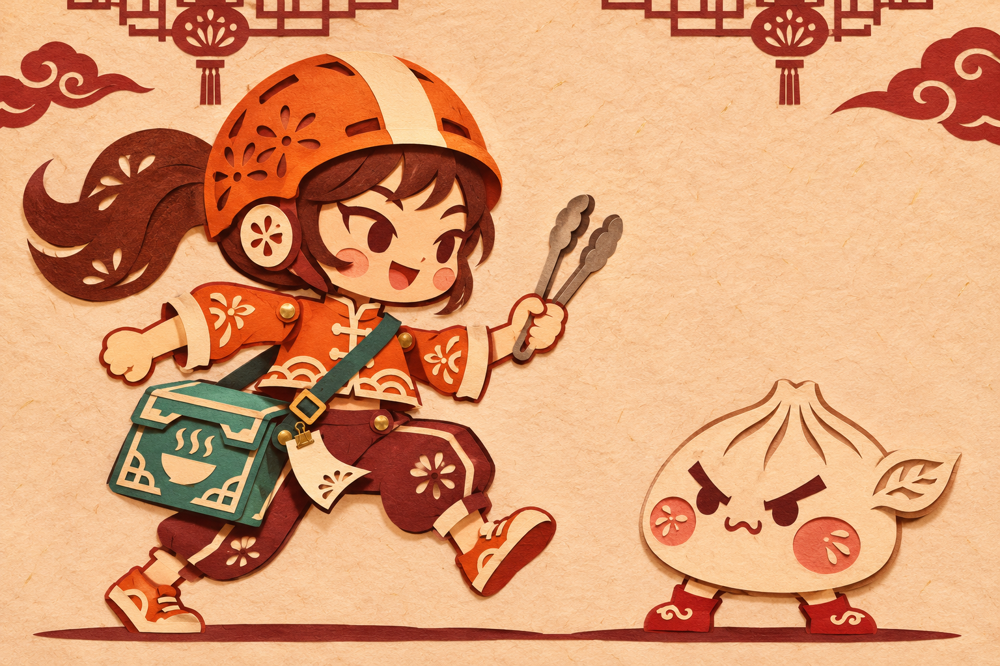
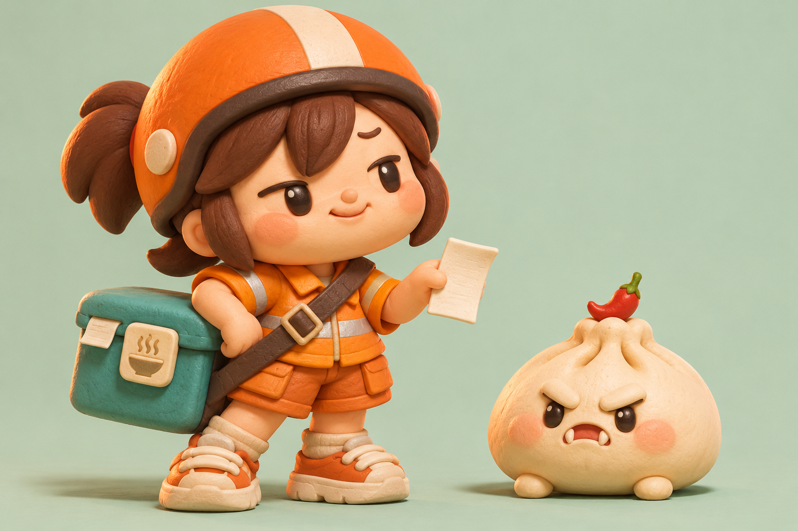
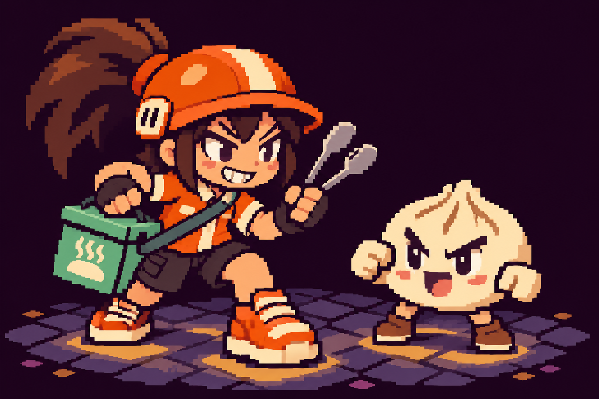

# 《夜市急送》Q 版角色方向

三张图使用同一名外卖员和同一类包子怪。橙色头盔、棕色马尾、青绿色保温箱和包子顶部的面褶用于对照造型。原画供选择美术方向，均为 1536 × 1024 PNG。

## A · 灯影剪纸

窗花纹样沿头盔、制服和马尾镂空，外卖员抬膝跨步。包子用歪眉、叶形面耳和一双红布鞋表达脾气。

## B · 软陶盲盒

外卖员胳膊夹着保温箱，手里拿着待核对的订单。包子头上的红辣椒、下垂的小牙和贴地的双脚与人物的大头短身相呼应。

## C · 街机像素

外卖员前脚踏实，举起取餐夹。包子也攥起面团拳头。深紫描边和大块明暗让两者的对峙姿态在小尺寸下容易辨认。

## 制作记录

2026-11-19 使用内置 imagegen，根据项目现有外卖员和包子怪的身份特征逐张生成，保留原始画面与分辨率。以下为各图的生成描述。

灯影剪纸

Create a finished horizontal 3:2 concept illustration for Night Market Rush, an original Chinese night-market delivery arcade game. EXACTLY TWO figures in total: one young adult female delivery courier on the left, one mischievous steamed bao bun creature on the right. Full bodies, feet and silhouettes completely in frame. Hero is a compact super-deformed two-heads-tall Chinese courier, her recognizable brown ponytail sweeping left, orange motorcycle helmet with a wide cream center stripe, cropped Mandarin-collar delivery jacket, diagonal strap and angular turquoise insulated satchel with a tiny steam-bowl symbol; a clipped cream order slip flutters. Left hand holds a small pair of ordinary food pickup tongs. Dynamic side-on bent-knee skipping step toward the little bao, chest twisting and smiling. The little bao has a big soft dumpling top tapering to one pleated peak, two mean curved eyebrows, two tiny red booted feet, puffed cheeks and one leaf-shaped ear of dough, comically trying to look fierce. Bao height about 45% of the courier's height. Fine Chinese festive folk paper cutting meets a highly designed SHADOW PUPPET THEATRE poster. Flat colour shapes with precise knife-cut negative spaces and decorative cut-throughs, thin golden pin joints in limbs of the courier, layered paper edge cast shadows, warm rice-paper fibres, vermilion, muted saffron, jade teal and oxblood. An elegant pale warm mulberry paper field with a few subtle burgundy cut paper cloud shapes in the corners, cropped lantern fretwork far above, generous negative space; keep silhouettes legible at game scale. Large characters filling the central spread, single ground plane. Editorial art direction, tactile artisan finish and a playful, proud face. No written words, no typography, no staged group, no duplicate poses, no panels, no HUD, no extra people or creatures, no faux writing, no photorealism. Treat this as a single hero-and-enemy comparison plate, not a game screenshot.

软陶盲盒

Produce a single premium studio character-design photograph, horizontal 3:2 format. Art toy concept for the original game Night Market Rush. EXACTLY ONE miniature female delivery courier figure on the left and EXACTLY ONE tiny steamed bao bun monster figure on the right, no other figures or faces anywhere. Render them as handmade soft CLAY / SATIN VINYL collectible toys. Unmistakably chibi: a squat girl with an extra-oversized head, about 1.6 heads tall, rounded mitt hands and chunky soft sneakers, little legs slightly askew under a huge head, chubby cheeks, tiny button nose, simple dark shiny eyes, relaxed crooked grin. Female courier recognizably has a brown stubby ponytail, a bulbous tangerine motorcycle helmet with a single cream racing stripe, short orange uniform with reflector tape, a thick diagonal strap and a chunky TIDAL-TEAL foam insulated box with a cream steaming-bowl clasp, a small folded receipt tucked under the box lid. Pose: stopped mid-delivery leaning gently toward the bao with one hand holding a blank order slip, other resting on her hip. Beside her a singular ivory hand-pinched dumpling with clear gathered dough pleats on top, very short feet at the bottom, tiny clay fangs and grumpy brow, belly almost on the floor, a pea-sized red chili sprout at its crown. Its face looks comically offended. Height 45% of the hero. Strong round solid masses, tiny sculpted details, warm subsurface highlights, believable contact shadows and subtle handmade material texture. Three-quarter front view, full figures with their feet visible and wide spacing, slightly low camera as in designer toy photography, both in clear focus. Solid pale celadon seamless backdrop flowing into the floor, warm broad studio key and subtle peach rim light. Sparse product art direction, generous margins. No packaging, no plinths, no typography, no writing, no layout frames or labels, no extra toy versions, no other props or characters. High end clay art that reads immediately at thumbnail scale.

街机像素

Make an original horizontal 3:2 TRUE LOW-RES PIXEL ART concept plate for Night Market Rush. Two big lovingly designed sprite figures only, each shown exactly once. On the left one chibi female Chinese delivery courier, on the right one chibi steamed bao bun monster, both whole from head to soles with breathing space. Chunky late-1990s handheld/action arcade sprite craft, sharp stair-step edges on a consistent coarse virtual pixel grid (approximately 192x128 low res enlarged by nearest neighbor), 14-color constrained palette, clusters of flat pixels, 1–2 pixel dark eggplant outlines, absolutely no smooth painted curves, no vector edges. Camera is the elevated 3/4 view of a top-down brawler. The courier is 2 heads tall, compressed torso, huge sideways nut-brown high ponytail peeking from her sharply slanted amber-orange helmet with one ivory reflective stripe, one raised eyebrow and an exaggerated confident grin, oversized orange-and-cream sneakers, black work shorts, an almost square mint insulated delivery box on a diagonal shoulder strap with a cream steam icon. Stepping hard on the front foot and swinging a small metal food gripper in a ready stance; readable silhouette. To her right an energetic SINGLE bright cream bao, peak pleated with five simple converging pixel clusters, tiny stomp boots, squat rectangular dough fists, furrowed brows, bouncing in a challenge pose; about half her height. Flatten the silhouettes and emphasize angular elbows, helmet brim, expressive eyes and sharp dynamic poses. Arrange both on the same short isometric patch of indigo night-market cobblestone with small light pools under their feet; near-black eggplant background with a sparse few purple and amber pavement pixels only. Restrained specular pixels, high value contrast, no gradients. Figures large and artifact legible; the stage only grounds them. No text, logos, UI, panels, extra characters, floating faces, duplicated sprites or motion ghosts, no action explosion obscuring them. This artwork itself is pixel art, not a photo or an arcade cabinet.

