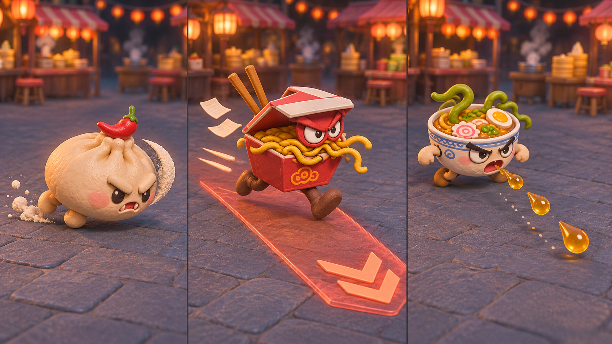
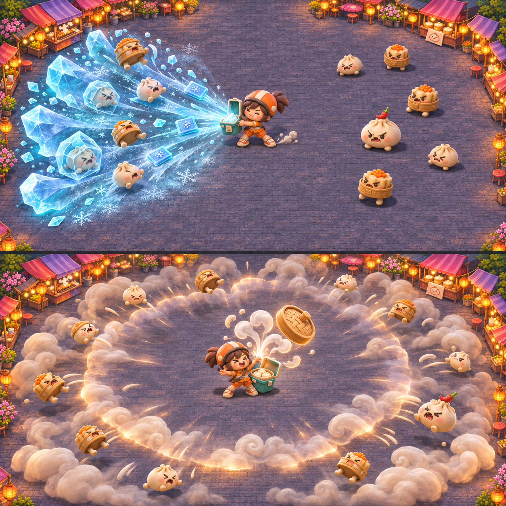
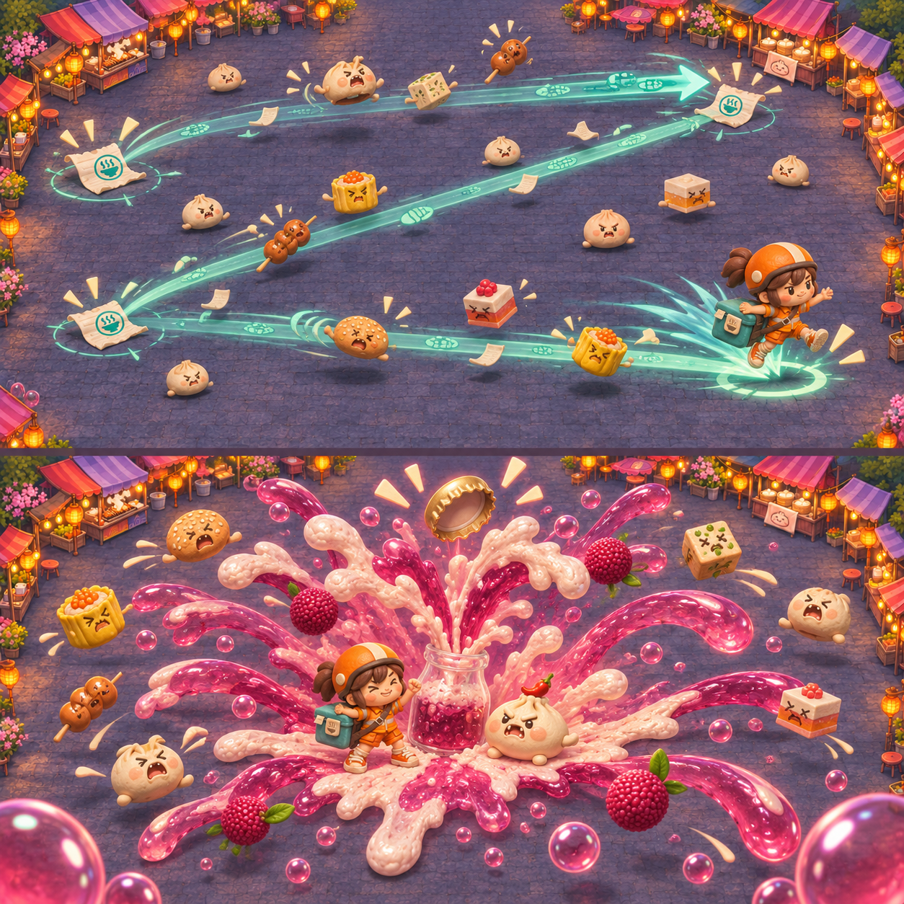
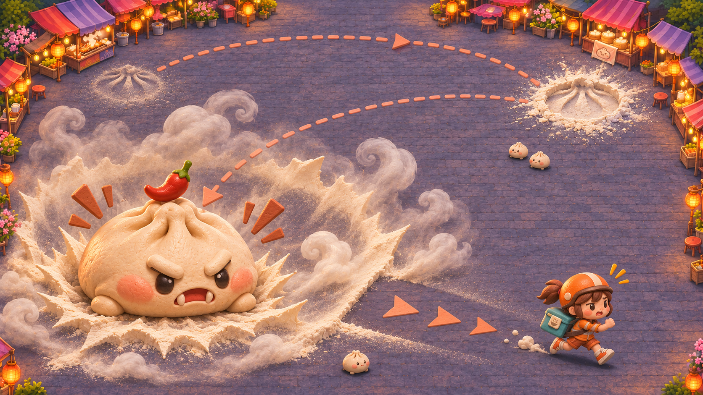

# 夜市急送 · 攻击特效概念

这组图沿用软陶盲盒外卖员、夜市摊位和食物小妖，保留了定稿时的动作、覆盖范围和节奏。巨包与四款外卖员大招已在本地版实装。首页进「配送试验场 → 实战试打」可逐招体验。[实装四招](../../../verification/clay/ultimates.webp) · [巨包三连坐实测](../../../verification/clay/giant.webp)

## 小怪出招

| 怪物 | 起手与攻击 | 玩家看哪里 |
|---|---|---|
| 包子怪 · 粉扑头槌 | 贴身时低头、后脚扬粉，额头擦出一道短月牙，撞上时面皮挤扁。月牙控制在一个身位以内。 | 看包子正脸和脚下，擦肩可以避开接触。 |
| 外卖盒怪 · 急件直送 | 压低盒盖，地上亮起一条带箭头的宽带。照现有规则预警 1.1 秒后沿锁定方向冲刺，盒尾甩出两张小票。 | 横移出宽带。小票落地就淡，后排盒怪的预警线仍然清楚。 |
| 大碗面怪 · 三口热汤 | 碗身后仰吸汤，细虚线锁向 0.9 秒。第一波单发，第二波起沿同一条线间隔 0.32 秒连吐三颗。 | 看分开的琥珀色汤珠，横移穿出弹道。 |

## 半屏冰浪与全屏热浪

- **保冷箱冰浪**。开箱前约 0.2 秒用移动方向对准密集的一侧，箱扣响起，三层碎冰在约 0.35 秒内由近推远。命中线上先压扁、再掀起一排敌人，另一半街面继续活动。手感重点是主动选对方向。
- **蒸笼开席**。掀盖时先听一声竹盖磕响，紧接着一圈贴地热汽在约 0.65 秒内从脚边推到四角。怪物在浪头抵达时依次弹起，内圈先露出地砖、掉币和下一件道具。外卖员可以追着浪头跑出去。

## 跨屏追击与炸屏爆发

- **加急三连送**。骑手投出带单据的快递包，包沿街来回三跳，每段约 0.24 秒。擦过的怪向两侧翻开，前两次落地盖短章，末次盖重章。骑手全程可移动、停步和冲刺，折返点的方向输入可偏转包的下一站。地面配送单和脚印标出快递包的路线。
- **杨梅汽水炸屏**。瓶内气泡先向瓶口收紧，约 0.18 秒后瓶盖弹起。瓶盖声、短顿与一次镜头轻震落在同一拍，莓红汽水和白泡随后向四边绽开，近处怪先飞，远处紧跟着翻滚。大前景气泡只擦过画面边角，中央约半秒后就能重新看清走位。

## 精英怪 · 巨包三连坐

巨包先压低面褶，第一处落点出现包褶印；玩家看到印记有约 0.65 秒换位。它左右交替连续跳砸，影子由小变大，每次落地留一处粉印，让人看得出它刚从哪边来。第三下蓄得最久，落地面皮压平，面粉浪沿地面炸开。预警圈从一开始就留出与最终粉浪相同的缺口，玩家可以提前穿过去，再趁它瘪在地上回身攻击。

## 图像来源

四张图由内置 imagegen 参照项目已有的软陶角色、怪物图集与夜市背景生成。参考截图用于比较同屏密度与技能覆盖尺度。两张大招图上下各展示一个不同技能的关键帧。
